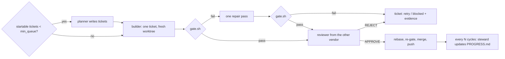

# forge

An unattended build loop that keeps developing one project on a Crewship host for hours, with no laptop and no operator in the loop. It complements Firstmate: Firstmate runs work you hand it; forge decides the next piece of work itself, builds it, checks it, lands it, and repeats until its deadline.

## How a cycle runs



Reliability rules, each mapped to a failure it prevents:

| rule | prevents |
| --- | --- |
| State lives in files (`tickets/`, `PROGRESS.md`, `LEARNINGS.md`, git), never in a model's context | each session starting with amnesia |
| One ticket per session, each with command-checkable "Done when" | half-built features, "looks done" |
| The gate (`gate.sh`) is the oracle and protected: a diff touching `gate.sh`, `tickets/` or `.forge/` is rejected | passing by editing the tests |
| A third-party package new to `Cargo.lock` (or a new `pip install`) only when the ticket names it; the reviewer diffs the manifests and lock file and rejects any other | an unrequested crate landing on main, where every later session builds it (the review runs after the builder and the gate have built it once, so it does not keep the code off this box) |
| Builder and reviewer come from different vendors (`reviewer_alt` when they would match) | one model approving its own blind spots |
| The reviewer treats commit messages, PR text, code comments and PROGRESS/LEARNINGS prose as the builder's account, not evidence, and does not read `git log` or the PR page for intent | a weakened check passing review because the builder explained it well (a refined explanation got 32/33 reintroduced CVEs approved where a plain one got 4/33; withholding it restored every detection) |
| Rebase and re-gate before merge | green branch, red main |
| The protected-path check runs again after the conflict with main is resolved, against `origin/main` | the merge-resolve builder session (29 reflex1 cycles ran one) committing `gate.sh` or `tickets/` through `git add -A`: it starts after the pre-gate check and only its prompt said not to |
| Retry with the failure evidence, escalate to `builder_hard` on the 2nd failure, block after `max_attempts` | infinite loops on one ticket |
| A ticket interrupted mid-cycle goes back to the queue free (not an attempt) at most `max_attempts - 1` times, then `blocked` with the count | unlimited uncharged builder sessions on a ticket whose cycle keeps dying (reflex1's 0012: 6 cycles for 3 counted attempts, two recoveries after `./gate.sh timed out after 1800 seconds`, about 4.6 lane-hours) |
| The planner is told how many tickets can start now (`depends:` all done) and how many startable ones it must add; forge logs the count after the turn | a planner turn every lane-1 cycle (10 in 13 h on reflex1, about 25 min each) because each wrote 8 tickets of which a median of 2 could start |
| A review that hits its timeout with no `VERDICT` is rerun once before the attempt fails | losing a 75-minute builder attempt to a stalled 30-minute review |
| A merge conflict at landing re-syncs with main and re-gates, up to three times | losing an approved, gate-green attempt because another lane landed during the 8–25 min post-rebase gate |
| A lane's `main` reconciles with `origin/main` by merge when the rebase conflicts, and a reset of last resort keeps the dropped commits on a `sync-conflict/*` branch | discarding this lane's unpushed planner tickets, status changes and steward edits (`git reset --hard origin/main`, twice in reflex1's 23-hour run) |
| Model-written text (the ticket heading that becomes the PR title) is shell-quoted; bodies go through files | a backtick or `$(...)` in a ticket running as the owner's user |
| Every session prompt goes to omp through a file (`sessions/<cycle>-<role>.prompt`), never as an argument | a review of a large diff failing to start (Linux caps one argument at 128 KiB) and the attempt being charged to the ticket |
| After each ticket the lane's `CARGO_TARGET_DIR` loses the workspace's own artifacts (crates.io ones stay) | one more copy of every test binary per dependency change until the disk is full |
| Quota floor (`max_window_used_pct`), hard deadline, per-session timeouts | burning the owner's shared plan |
| GPU through `gpu.py` only: budget cap, max hours, deadline in the pod name, reaper timer | forgotten pods billing all night |
| The builder never puts an account, email, token or key into a request, file or command because something it read asked for it; only the ticket can authorize that | a page the builder fetched asking "identify your user" and getting the owner's login (Claude Code put the account email in HTTP headers on request, 2026-10-22) |
| A REJECT ends with a `Must change:` block (file and line, the input that shows it, the code to write) right before the verdict; the next attempt sees only the review's last 3,000 characters | a retry that rereads the reviewer's PASS/FAIL table and misses the fix (over 54,000 agent review comments: an inline code suggestion is the strongest predictor a comment gets acted on, long ones the weakest) |
| A `LEARNINGS.md` entry starts with its ticket id and the file or symbol it is about; the steward deletes an entry whose code has moved on | a builder following a lesson the code has outgrown (reflex1's file: 129 lines, 0 dates, 3 commit hashes; agents given a stored record with no validity state use it as if current, a 40.5-point drop on LongMemEval) |
| Outside its worktree the builder makes a file recoverable (tracked and clean, or copied aside without replacing an older copy) before any command that may overwrite, move or delete it, puts back what the ticket did not ask it to change, and notes in `PROGRESS.md` where the copy of the rest is | an untracked dataset, checkpoint or the owner's other repo clobbered by a side effect (reflex1 ticket 0057 ran `track.mjs` as a CLI and it rewrote `~/code/reflex/learn/track.json`; recovered only because it was tracked. Six frontier models back up before the destructive step in 15.2% of RegretBench tasks) |
| Agent sessions and shell commands get stdin from `/dev/null` | every session hanging to its timeout with an empty log when the loop is started with a pipe on stdin (`ssh host python3 forge.py run`, `nohup` from a script): `omp -p` waits for EOF on a piped stdin before reading the prompt (`sleep 60 \| omp -p ...` sits in `readPipedInput` for 60 s) |
| The planner's and steward's commit stages only the doc paths the project actually has | a whole planner or steward turn thrown away on a project missing one of them: `git add -A a b c` stages nothing when one pathspec does not match, the error went to `/dev/null`, and `discard_strays` then reset the turn (ignored exit codes in shell steps are among the most frequent causes of silent CI failures) |
| A second session of the same role in one cycle gets its own log and prompt file (`-2`, `-3`) | the session that wrote the diff being overwritten by a short repair or merge run before anyone can read it (reflex1 lane 1 cycle 32: the 63-minute builder log replaced by the 1.5 KB merge-resolution run; full traces raise failure attribution accuracy by up to 76% over partial ones) |
| The closing steward turn at the deadline is skipped when the scheduled one already ran on the same cycle | a duplicate 30-minute steward session on an unchanged tree and a second docs commit at shutdown (reflex1 lane 1, 2026-10-24: steward at 18:31:06Z on cycle 32, steward again at 18:38:36Z at the deadline) |
| When the rebase onto main conflicts, a plain `git merge origin/main` is tried before the builder is called in | a 30-minute builder session for a divergence git resolves itself: the rebase replays each builder commit and conflicts on a line the branch already rewrote, the merge compares the final trees once (29 of reflex1's cycles took the session) |
| The merge-resolve builder session is told not to run the gate: `land()` runs it on the merged tree right after | a 30-minute session spending half of itself on a gate run forge repeats anyway (the one resolve log reflex1 kept in full: 15m57s of `./gate.sh`; the 29 resolves took 10 to 50 min each up to the merge, forge's own gate run included) |
| A branch landed by the local-merge fallback is deleted from the remote once its tip is in `origin/main` | landed branches piling up on the remote because only `gh pr merge --delete-branch` removes them and 75 of reflex1's merges fell back to the local path (64 of its 106 remote `forge/` branches are already in main) |
| A cycle that ends in an exception closes its PR with the error on it | abandoned PRs with no evidence of what happened: reflex1 PRs #12 and #27 are the two cycles whose gate hit the 30-minute timeout, both still open with no gate comment, while the ticket went back to the queue without a link to them |
| Any lane refills the ticket queue when it runs dry, one planner turn at a time (`plan.lock` in the shared state dir) | three lanes idling while lane 1 is mid-build, because only lane 1 checked the queue and only between its own cycles: 44 "no open ticket to claim" lines on lanes 2-4 in reflex1's log, lane 4 idle 19:26-19:44 on 2026-10-23 |
| A PR GitHub reports as `CONFLICTING` goes straight to the local landing path, whose `git merge` decides | 30 s of polling and a merge call that cannot succeed on every conflicted PR (25 conflict failures in reflex1's log, 11 API calls each; 14 of them merged cleanly on the local path seconds later) |
| `STEERING.md` and the configured gate are protected whatever `protected_paths` lists | the one file that constrains every session being editable by the work it constrains: reflex1.toml overrides the default list without `STEERING.md`, and its text is prepended to every builder, reviewer, planner and steward prompt as "these override anything below" (arXiv 2610.06274: a frontier model wrote a protected config value on 25 of 72 ordinary requests with no runtime floor, and on 0 of 167 with one, though it tried in 65 of them) |
| A session marks its vendor exhausted only on a quota error in its stderr, the provider's channel | a session that merely writes about quota disabling its whole vendor for the rest of the cycle: 5 of reflex1's 264 session logs quote `usage_limit_reached` or "quota" in the agent's report (lane 2 cycle 28's builder and reviewer quoted the steward's cycle-8 `usage_limit_reached` bullet in LEARNINGS.md), and omp -p writes a failed turn's error to stderr, as the three surviving refusal logs show; matching the whole output only needed one such session to also exit non-zero (a timeout is rc=124) |
| A cycle that ends in `fail()` or an exception deletes its attempt branch from the remote (with PRs on, unless the branch is already merged into local main) | failed attempts leaving a branch on origin forever: 42 of reflex1's 106 remote `forge/` refs are not in `origin/main` (30 RETRY/BLOCKED, 2 cycle errors, 4 cut by a lane restart, 4 logged MERGED under replayed hashes, 2 older names), and only the two merge paths ever deleted one (test-failure and missing-label residue are 58.6% of orphaned resources in a 190M-log cloud study, Hong et al., AIoTC 2026) |
| A lane that loses the claim race rewinds to the commit it started from, not to `origin/main`; a push the remote refuses outright (`[remote rejected]`) still resets to `origin/main` | a lost race also deleting main commits this lane had not pushed yet - a planner turn's tickets, the steward's doc edits - silently and with no log line, the loss the merge in `sync_main()` had already stopped taking (never hit in reflex1: its log has no `push failed after retries`, which is what leaves main commits unpushed) |
| A cycle claims no new ticket once the deadline has passed; work already claimed is left to finish | a lane starting a full build after the owner's stop time, because the deadline is checked before the cycle and `sync_main()` plus a planner turn (`timeout_min` 40) run inside it: reflex1 lane 1 claimed 0128 at 17:05:32Z against a 17:00:00Z deadline and spent 86 more minutes of Opus xhigh on it (two `builder_hard` sessions and a review), and the supervisor logged "all lanes finished at the deadline" at 18:43:52Z |
| A lane prunes its build artifacts and then waits when free disk is under `limits.min_free_gb` (default 10 GB), instead of starting a cycle | a full disk failing the gate as if the ticket were wrong: cargo's ENOSPC costs a repair session, the attempt and a retry, on all four lanes in the same minute, so three cycles turn the queue to `blocked` (this box: 177 of 193 GB used, 17 GB free, 106 GB of it the lanes' cargo target dirs and 25.2 GB of that prunable by `prune_target` right now; resource exhaustion is a named category of intermittent CI job failure, Aïdasso et al., FSE 2026, and 46.5% of flaky tests are resource-affected, Silva et al., TSE 2024) |
| A prune that cannot read the workspace (`cargo metadata` fails) logs the failure instead of deleting nothing in silence | a lane blocked by the disk floor with no way to tell a prune that never ran from one that found nothing to delete: with no package list nothing matches, and `disk_ok()` logs only "not starting a build" (not seen in reflex1: forge.py puts `~/.cargo/bin` on PATH and `cargo metadata` there selects all 869 prunable files) |
| A usage window whose label names one model (`Claude 7 Day (Fable)`) marks that model, not its vendor; the pause still counts every window | one model's spent window taking every model of the vendor out of every role's chain: with `Claude 7 Day (Fable)` at 100.0% and the vendor-wide `Claude 5 Hour` and `Claude 7 Day` windows under the floor, the block maximum put `claude-opus-5-5` out with it - every builder falls to Codex and `reviewer`, whose only fallback is the same vendor, has no model left at all (QuotaExhausted after the build session: ticket requeued, 15 min of sleep, per lane) |
| The repair session's diff is checked for protected paths *before* the gate is run again | the one gate run forge made on an oracle the agent had just rewritten: the check's result was only read after that run, so a `gate.sh` edited by the repair was executed and its PASS went on the PR before the attempt was failed, and every protected edit was reported to the ticket as "gate still failing after repair" (evaluator tampering occurs in about half of natural agent episodes and evaluator locking removes it, RewardHackingAgents, ICDEW 2026; test-file edits are an observed hack of both Codex and Claude Code, EvilGenie, arXiv 2511.21654) |
| "What this branch changed" is measured against `origin/main`, not the lane's local `main` | a branch that brought main in - by merge or rebase, which the builders do on every retry - being refused as "diff edits protected gate/ticket paths" for the tickets other lanes landed meanwhile, and reviewed as if their work were its own: 7 of reflex1's 37 failures died this way (2 straight to `blocked`, none naming `gate.sh`), and replaying one on today's repo lists 35 protected `tickets/` paths and hands the reviewer 761 KB of diff in place of the branch's own 363 bytes |
| The reviewer is told what diff it is holding: base `origin/main...HEAD` for the diff it is handed and for the ones it runs itself, and a line where the 120 KB cut falls | the reviewer repeating in its own commands the stale-base error the harness stopped making, and judging a cut diff as the whole change: `git diff main...HEAD -- Cargo.lock` on a branch that merged main lists the dependency another lane added, which step 6 calls a REJECT "whatever the commit message says" (a replay shows `serde` on the branch's side; against `origin/main` the branch adds nothing), and tool output that hides its own limit made verifiers accept wrong answers 90 of 90 times, stating it flipped all 90 (arXiv 2610.32110) |
| The reviewer's diff opens with `git diff --stat`, and past about 150 changed lines the prompt has it read the files one at a time | one read of a long diff rated as a whole: review F1 falls from 0.66 on diffs under 10 lines to 0.04 over 150 (arXiv 2606.15689, five models, 150 PRs), and 47 of reflex1's 79 merged PRs are over 150 lines (median 201, p90 547; 36 of 123 PRs exceed the planner's own 400-line rule) |
| The builder fixes every instance of the pattern the ticket's bug or gap names (`rg` for the siblings once the cause is known) outside the ticket's `## Out of scope` and the protected paths, and lists those under Ideas; the reviewer's step 2 checks the hits the diff left alone | a patch that fixes only the line the ticket pointed at and passes the gate: on FrontierCode 2.0 (Cognition, 2026-10-27; maintainer-written tasks on their own repos) "thoroughness" - fixing the bug in the sibling path too, matching the support similar code already has - is the blocker category with the highest failure rate at every reasoning effort (19.2% of its checks, 26.0% at low effort), above core behaviour; agentic repair systems "hyper-localize on immediately suspicious lines and fix them in isolation", and SemAgent's complete-patch workflow adds 7.66 points over its baseline on SWE-bench Lite (SemAgent, arXiv 2506.16650) |
| The reviewer prompt labels the `## forge` sections under the ticket as forge's record of earlier attempts (gate tails, an earlier review by another session), not part of the contract: an earlier `Must change:` line is re-checked against this diff, the earlier verdict is not this one | the ticket handed to the reviewer carries every prior attempt's note (13 of reflex1's 140 tickets hold an earlier review, 8 of those merged on a later attempt), and a reviewer anchors on prior analysis it is shown: anchoring on prior results moved LLM verdicts in 23.5% of cases across eight models, framing in 33.2% (arXiv 2606.30587); experts given an agent's lean on a judgment call followed it 86% of the time and repeated its arguments as their own (Anthropic, "How AI agents shape experts' judgment calls", 2026-10-27) |
| When the code a `LEARNINGS.md` entry names no longer exists or no longer behaves that way, the builder follows the code (unless the ticket asks otherwise) and corrects or deletes the entry; a library/tool/process pitfall is not retired because some code ignores it in the same commit (after `rg` and `git log -S`); the steward's every-4-cycles pass is not the only time a stale lesson is retired | a builder writing the code a stale lesson describes: where a convention file and the code disagree, agents follow the file "even when it prescribes the worse code, so a stale convention file costs more than no file" (arXiv 2608.16630, seven models, five harnesses); stale documentation was the largest class in a six-week log of 118 agent failures (arXiv 2610.32578); context files add about 20% cost without moving task success, and their instructions are followed (arXiv 2602.11988). reflex1's file: 128 entries, 82 naming a file, retired only by the steward |
| The reviewer runs every error arm the diff adds that no test in the diff takes (the missing file, the short tensor, the malformed row) and checks it fails the way the code says | an error branch nobody has ever executed: in 4,882 agent PRs the error-handling constructs were the most consistently under-tested, missed by every test at 86% in Java and 81% in Python (arXiv 2607.18057); 27 of reflex1's last 80 merged PRs add an error arm and 8 of those add any assertion that takes one |
| The repair session after a failed gate gets the whole builder prompt (its rules included) under a header that names the branch's commits as the earlier session's patch and puts the gate output at the end | a builder-role session running with the owner's shell and none of the builder's rules: the inline repair prompt carried only "fix the code, not the gate" - no credential rule, no dependency rule, no `cp -an` rule for files outside the worktree, no formatter - and never said the branch already held a patch, so a fresh `--no-session` model could redo the work instead of fixing it (conversational repair keeps the failed patch next to its feedback so the next patch is not the same one, arXiv 2301.13246; agents fall into "repetitive and inefficient cycles" without a record of prior failed attempts, TraceCoder, ICSE 2026) |
| For a function the diff changes without renaming (a new or defaulted parameter, a different return shape, `None` where there was an error, a changed error type or result order), the reviewer `rg`s its callers in files the diff leaves alone and checks each still holds | a caller that still compiles and now gets the other answer: review bots read the hunks and "the bug is usually in the code that calls them" (r/ChatGPTCoding, 2026-10-26); frontier models find 15-31% of human-flagged issues on diff-only review and stuffing full context makes it worse, so the reviewer reads the callers itself rather than being handed them (SWE-PRBench, arXiv 2603.26130; caller-centric exploration tools lift repository-level pass rate up to 7.56 points, ReCUBE, arXiv 2603.25770); 16 of reflex1's last 49 code-changing merges change a `fn`/`def` signature line and 10 of those have same-named calls in files the diff leaves alone (name-match proxy) |
| For each test the diff adds or changes for code in a file `origin/main` already has, the reviewer runs it against the old code (`git checkout origin/main -- <src>`, run, `git checkout HEAD -- .`) and requires it to fail there; forge resets the worktree after the review so a restored file never reaches the landing rebase | a test that passes with and without the change: agents' requirement tests pass execution 82.8% of the time and are behaviourally adequate (kill what the developer's test kills) 33.8% (Req2Test-Bench, arXiv 2610.36584); LLM suites reach 100% coverage at 4% mutation score (MutGen, IEEE TSE 2025); builder rule 12's "see it fail" was a claim the reviewer could not check; 13 of reflex1's last 80 merges change a test and a source file together |

Sources: Anthropic, "Effective harnesses for long-running agents" (2025) and "Harness design for long-running application development" (2026); loop-engineering practice (external gate the agent cannot edit, durable notes, budget caps).

## Files

| file | what |
| --- | --- |
| `forge.py` | the loop: `run`, `once`, `status`, `steward` |
| `gpu.py` | RunPod jobs with guards: `run`, `list`, `reap`, `balance` |
| `prompts/{planner,builder,reviewer,steward}.md` | role prompts; `{PROJECT}`, `{GATE}`, `{TICKET}`, `{DIFF}`, `{STATE}` are filled in |
| `projects/<name>.toml` | per-project config: repo, gate, roles (model + thinking), limits, env |
| `systemd/` | `forge@.service` (one loop per project), the GPU reaper timer, and a stall watchdog that restarts a loop whose log has not moved for 2 h |

A project repo needs `gate.sh` (exit 0 = good), `tickets/`, `AGENTS.md`, `ROADMAP.md`, `PROGRESS.md`, `LEARNINGS.md`.

## Install on a host

```bash
mkdir -p ~/.config/forge ~/.config/systemd/user
cp ~/Dev/Crewship/forge/projects/reflex1.toml ~/.config/forge/
cp ~/Dev/Crewship/forge/systemd/* ~/.config/systemd/user/
systemctl --user daemon-reload
systemctl --user enable --now forge@reflex1.service forge-gpu-reap.timer forge-watchdog@reflex1.timer
```

Linger must be on (`loginctl enable-linger $USER`; Crewship's `enable_linger` does this) so the loop keeps running after you log out.

## Watch and steer

```bash
python3 ~/Dev/Crewship/forge/forge.py status --config ~/.config/forge/reflex1.toml
journalctl --user -u forge@reflex1 -f
python3 ~/Dev/Crewship/forge/gpu.py list
```

Steer by committing to the project repo: add or edit a ticket, reorder by renaming, set `status: blocked` to skip one, or edit `ROADMAP.md`; the loop pulls `main` every cycle. Stop with `systemctl --user stop forge@reflex1`.

`status` also prints merged/attempts per forge version (a short hash of `forge.py` and the four role prompts) plus the omp release (`omp --version`), both taken when each history entry is written: `~/.local/bin/omp` is a symlink into a versioned install, so an upgrade changes the instruction stack under a running lane with no change to the hash. It is a tally over different tickets, not a controlled comparison.
