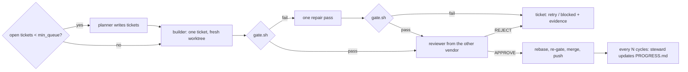

# forge

An unattended build loop that keeps developing one project on a Crewship host for hours, with no laptop and no operator in the loop. It complements Firstmate: Firstmate runs work you hand it; forge decides the next piece of work itself, builds it, checks it, lands it, and repeats until its deadline.

## How a cycle runs



Reliability rules, each mapped to a failure it prevents:

| rule | prevents |
| --- | --- |
| State lives in files (`tickets/`, `PROGRESS.md`, `LEARNINGS.md`, git), never in a model's context | each session starting with amnesia |
| One ticket per session, each with command-checkable "Done when" | half-built features, "looks done" |
| The gate (`gate.sh`) is the oracle and protected: a diff touching `gate.sh`, `tickets/` or `.forge/` is rejected | passing by editing the tests |
| A third-party package new to `Cargo.lock` (or a new `pip install`) only when the ticket names it; the reviewer diffs the manifests and lock file and rejects any other | an unrequested crate landing on main, where every later session builds it (the review runs after the builder and the gate have built it once, so it does not keep the code off this box) |
| Builder and reviewer come from different vendors (`reviewer_alt` when they would match) | one model approving its own blind spots |
| Rebase and re-gate before merge | green branch, red main |
| Retry with the failure evidence, escalate to `builder_hard` on the 2nd failure, block after `max_attempts` | infinite loops on one ticket |
| A review that hits its timeout with no `VERDICT` is rerun once before the attempt fails | losing a 75-minute builder attempt to a stalled 30-minute review |
| A merge conflict at landing re-syncs with main and re-gates, up to three times | losing an approved, gate-green attempt because another lane landed during the 8–25 min post-rebase gate |
| Model-written text (the ticket heading that becomes the PR title) is shell-quoted; bodies go through files | a backtick or `$(...)` in a ticket running as the owner's user |
| After each ticket the lane's `CARGO_TARGET_DIR` loses the workspace's own artifacts (crates.io ones stay) | one more copy of every test binary per dependency change until the disk is full |
| Quota floor (`max_window_used_pct`), hard deadline, per-session timeouts | burning the owner's shared plan |
| GPU through `gpu.py` only: budget cap, max hours, deadline in the pod name, reaper timer | forgotten pods billing all night |

Sources: Anthropic, "Effective harnesses for long-running agents" (2025) and "Harness design for long-running application development" (2026); loop-engineering practice (external gate the agent cannot edit, durable notes, budget caps).

## Files

| file | what |
| --- | --- |
| `forge.py` | the loop: `run`, `once`, `status`, `steward` |
| `gpu.py` | RunPod jobs with guards: `run`, `list`, `reap`, `balance` |
| `prompts/{planner,builder,reviewer,steward}.md` | role prompts; `{PROJECT}`, `{GATE}`, `{TICKET}`, `{DIFF}`, `{STATE}` are filled in |
| `projects/<name>.toml` | per-project config: repo, gate, roles (model + thinking), limits, env |
| `systemd/` | `forge@.service` (one loop per project), the GPU reaper timer, and a stall watchdog that restarts a loop whose log has not moved for 2 h |

A project repo needs `gate.sh` (exit 0 = good), `tickets/`, `AGENTS.md`, `ROADMAP.md`, `PROGRESS.md`, `LEARNINGS.md`.

## Install on a host

```bash
mkdir -p ~/.config/forge ~/.config/systemd/user
cp ~/Dev/Crewship/forge/projects/reflex1.toml ~/.config/forge/
cp ~/Dev/Crewship/forge/systemd/* ~/.config/systemd/user/
systemctl --user daemon-reload
systemctl --user enable --now forge@reflex1.service forge-gpu-reap.timer forge-watchdog@reflex1.timer
```

Linger must be on (`loginctl enable-linger $USER`; Crewship's `enable_linger` does this) so the loop keeps running after you log out.

## Watch and steer

```bash
python3 ~/Dev/Crewship/forge/forge.py status --config ~/.config/forge/reflex1.toml
journalctl --user -u forge@reflex1 -f
python3 ~/Dev/Crewship/forge/gpu.py list
```

Steer by committing to the project repo: add or edit a ticket, reorder by renaming, set `status: blocked` to skip one, or edit `ROADMAP.md`; the loop pulls `main` every cycle. Stop with `systemctl --user stop forge@reflex1`.

`status` also prints merged/attempts per forge version (a short hash of `forge.py` and the four role prompts, taken when each history entry is written); it is a tally over different tickets, not a controlled comparison.
